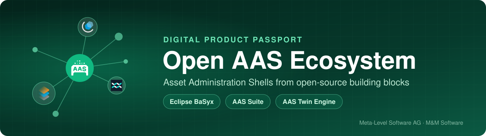
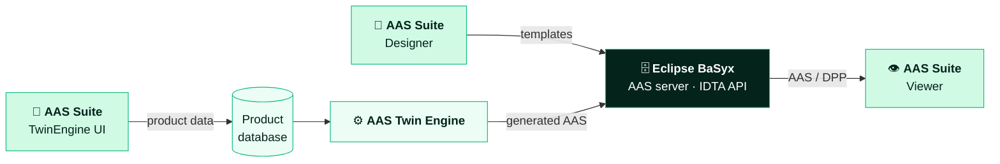

<p align="center">
  
</p>

<p align="center">
  <a href="LICENSE"></a>
  
  
  <a href="https://aas-ecosystem.de"></a>
</p>

<p align="center">
  <a href="#-quick-start"><b>Quick start</b></a> ·
  <a href="#-what-you-get">What you get</a> ·
  <a href="#-how-it-fits-together">How it fits together</a> ·
  <a href="#-whats-next">What's next</a> ·
  <a href="https://aas-ecosystem.de">Website</a>
</p>

---

The **Open AAS Ecosystem** shows how existing open-source components combine into a
complete environment for **Asset Administration Shells (AAS)**. The first use case is the
**Digital Product Passport (DPP)**: design templates, feed in product data, and get
standard-compliant AAS that you can view and query through the IDTA API.

Everything runs locally with **one `docker compose up`**, including demo data, login and
IDTA submodel templates.

## 🧩 What you get

| | Component | Role in the ecosystem | Links |
|:-:|---|---|---|
| 🎨 | **AAS Suite** <br><sub>by Meta-Level Software AG</sub> | Web frontend: template editor (Designer) and viewer for the AAS | [GitHub](https://github.com/meta-level-public/aas-suite-community) · [aas-suite.de](https://aas-suite.de) |
| ⚙️ | **AAS Twin Engine** <br><sub>by M&M Software</sub> | Generates the AAS for the DPP from product data in a database | [GitHub](https://github.com/AAS-TwinEngine) · [Product page](https://www.mm-software.com/what-we-do/software-engineering/design/industrie-40/aas-twinengine/) |
| 🗄️ | **Eclipse BaSyx** | AAS server: repositories, registries and discovery with the IDTA-compliant API | [GitHub](https://github.com/eclipse-basyx/basyx-go-components) · [Wiki](https://wiki.basyx.org) |
| 🔐 | **Keycloak** | Login and access control for all parts of the stack | [keycloak.org](https://www.keycloak.org) |

Included out of the box:

- **IDTA submodel templates** for Nameplate, Technical Data, Carbon Footprint,
  Handover Documentation and Maintenance Instructions
- **Demo products** with complete data, ready to view as AAS
- **TwinEngine UI**, a plugin in the AAS Suite for editing product data in the browser
- **DPP API and DPP gateway** from Eclipse BaSyx for serving product passports

## 🔄 How it fits together



1. In the **AAS Suite** you create and adjust the templates for your product passport.
2. Product data goes into the **Twin Engine** database, for example through the TwinEngine UI.
3. When the AAS is requested through the IDTA API, the **Twin Engine** generates it from
   template and data, and **BaSyx** serves it.
4. The **viewer** in the AAS Suite shows the result.

## 🚀 Quick start

**You need:** Docker with Docker Compose v2 and a few free ports (see [Services](#-services)).

**1. Get the code**

```bash
git clone https://github.com/aas-ecosystem/aas-ecosystem.git
cd aas-ecosystem/examples/aas-ecosystem
```

**2. Create the configuration** – pick the template for your machine:

```bash
cp .env.example .env        # Intel/AMD (x86_64)
# or
cp .env.example-arm .env    # ARM, e.g. Apple Silicon
```

**3. Make the hostname resolvable.** Add this line to your hosts file
(`/etc/hosts` on macOS/Linux, `C:\Windows\System32\drivers\etc\hosts` on Windows):

```text
127.0.0.1 aas-ecosystem.local
```

**4. Start the stack**

```bash
docker compose up -d
```

The first start takes a few minutes: images are pulled, databases are migrated, and
templates and demo data are imported.

**5. Open [http://aas-ecosystem.local](http://aas-ecosystem.local)** and sign in with the
organisation admin from [Default logins](#-default-logins).

## 🌐 Services

| Service | Address |
|---|---|
| AAS Suite (Designer, viewer, plugins) | http://aas-ecosystem.local |
| Keycloak admin console | http://localhost:8088 |
| AAS Twin Engine | http://localhost:8090 |
| DPP gateway | http://localhost:5090 |
| pgAdmin (local only) | http://127.0.0.1:5050 |
| PostgreSQL | `localhost:5444` |

To use another hostname, change `LOCAL_HOSTNAME` in `.env`. All URLs, including login
and API, follow it.

## 🔑 Default logins

| Where | User | Password |
|---|---|---|
| AAS Suite (organisation admin) | `admin@initial.orga` | `secret-pass` |
| Keycloak admin console | `admin` | `admin` |
| PostgreSQL | `aas_user` | `admin-pass` |

> [!WARNING]
> These credentials, and the secrets in `.env.example`, are for the local demo only.
> Change all of them before you run the stack anywhere other people can reach it.

## 🗂️ Repository layout

```text
examples/aas-ecosystem/
├── docker-compose.yml          the complete stack
├── .env.example(-arm)          configuration template
├── postgres-init/              Twin Engine database: schema and demo data
├── stack-assets/aas-import/    IDTA templates imported at startup (AAS XML)
├── plugins/                    AAS Suite plugins, incl. TwinEngine UI source
├── infrastructure-bootstrap/   preconfigured AAS infrastructures in the AAS Suite
├── keycloak-bootstrap/         Keycloak clients for the DPP services
└── dpp-security/               access rules for the DPP API
```

## 🔭 What's next

The Digital Product Passport is the first use case. The stack is built so that more
can be added on top of it:

- **More use cases.** The included templates for carbon footprint, maintenance,
  technical data and documentation reach well beyond the DPP.
- **More components.** Further BaSyx services and other tools from the AAS world can
  join the network; access control through Keycloak is already in place.
- **Your own plugins.** The AAS Suite loads GUI plugins from `plugins/`; see the
  [plugin guide](examples/aas-ecosystem/plugins/README.md).

## 🤝 Who is behind it

The Open AAS Ecosystem is a joint initiative of
**[Meta-Level Software AG](https://meta-level.de)** and **[M&M Software](https://www.mm-software.com)**,
together with **[SEQLY](https://seqly.de)**.

All components are open source. Contributions, feedback and new partners are welcome:
open an [issue](https://github.com/aas-ecosystem/aas-ecosystem/issues) or
[get in touch](https://aas-ecosystem.de/en/contact.html).

## 📄 License

[Apache License 2.0](LICENSE). The bundled components keep their own licenses.
